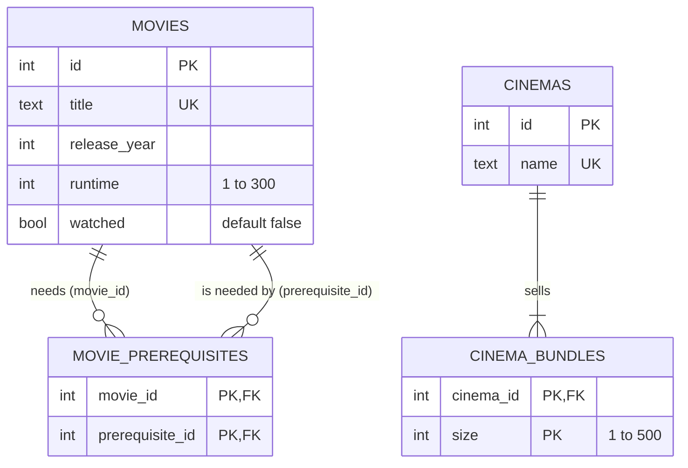

# Doomsday Ready

A small full-stack app for planning an MCU rewatch before *Avengers: Doomsday* and booking an opening-night watch party.

- **Backend:** Node.js, Express, SQLite (`better-sqlite3`)
- **Frontend:** React (Vite)
- **Tests:** Node's built-in test runner (`node:test`)

## Run it

**With Docker (one command):**

```bash
docker compose up --build
```

Open http://localhost:8080. The API is behind the same address under `/api`. Sample data from the brief is loaded on first start.

**Without Docker:**

```bash
# terminal 1
cd backend && npm install && npm start        # http://localhost:3001

# terminal 2
cd frontend && npm install && npm run dev     # http://localhost:5173
```

Run the tests with `cd backend && npm test`.

## How the two core features work

Both are written by hand with no graph or algorithm libraries (see `backend/src/lib/`).

### Rewatch order (`lib/graph.js`)

Movies form a directed graph: an edge from a movie to each of its prerequisites.

- **Rewatch order:** a depth-first traversal from the target. A movie is added to the result only after all of its own prerequisites have been added (post-order), so every movie comes after what it needs. A `visited` set makes sure each movie appears once, even in diamond shapes. The target itself is left out. Time is O(movies + links).
- **Circular dependency check:** when prerequisites are set on movie `M`, I walk the graph from the new prerequisites. If `M` is reachable, the change would close a loop, so the API answers `409 CIRCULAR_DEPENDENCY` and nothing is saved. This covers self-reference (`M` listing itself) and long indirect loops. A newly created movie cannot be part of a loop because nothing depends on it yet.
- Both are iterative (explicit stack), so a very long chain cannot overflow the call stack. There is a test with 50,000 chained movies.
- The response also includes `watchedCount`, `totalCount` and `remainingMinutes` (runtime of the unwatched ones only).

### Booking quote (`lib/bundles.js`)

This is the "fewest coins to make an exact amount" problem. A greedy approach is wrong (for bundles 1, 3, 4 and 6 seats, greedy picks 4+1+1 = 3 bundles, but 3+3 = 2 bundles is better), so I use dynamic programming:

- `best[n]` is the fewest bundles that seat exactly `n` people, built up from `best[n - size] + 1` for each bundle size.
- `choice[n]` remembers the last bundle used so the answer can be rebuilt by walking back from the group size.
- If `best[groupSize]` stays infinite, the response says it is not possible.
- Time O(groupSize x number of sizes), at most 10,000 x 10 steps.

If two combinations use the same number of bundles, the one with larger bundles is returned (deterministic).

## API

All under `/api`. Errors look like `{ "error": { "code": "...", "message": "..." } }`.

| Method and path | Purpose |
| --- | --- |
| `POST /movies` | Create a movie (or an array of movies, all or nothing) |
| `GET /movies` | List movies, each with its `prerequisites` (ids) |
| `GET /movies/:id` | One movie |
| `PATCH /movies/:id` | Update any of `title`, `releaseYear`, `runtime`, `watched`, `prerequisites` |
| `GET /movies/:id/rewatch-order` | Ordered prerequisites, watched count, remaining minutes |
| `POST /cinemas` | Create a cinema with `name` and `bundleSizes` |
| `GET /cinemas` | List cinemas |
| `GET /cinemas/:id/booking?groupSize=6` | Fewest bundles for exactly that many seats |
| `GET /health` | Health check |

Status codes: `400 VALIDATION_ERROR`, `404 NOT_FOUND`, `409 CIRCULAR_DEPENDENCY`, `409 DUPLICATE_TITLE`, `409 DUPLICATE_NAME`.

Example booking response:

```json
{
  "cinema": { "id": 1, "name": "Star Cineplex Dhaka" },
  "groupSize": 11,
  "possible": true,
  "bundleCount": 4,
  "bundles": [{ "size": 5, "count": 1 }, { "size": 2, "count": 3 }]
}
```

## Data model



`MOVIE_PREREQUISITES` is a many-to-many link from movies to movies. The database also forbids a movie being its own prerequisite; longer loops are caught in code.

## Choices I made where the brief was unclear

- **Release year range:** the brief gives 1 to 300 for runtime only, so I accept years 1888 to 2100.
- **Title and cinema name uniqueness** ignore case and surrounding spaces ("iron man" clashes with "Iron Man").
- **Prerequisites are sent as movie ids.** An id that does not exist returns 400.
- **"Not possible" is a normal answer** (`200` with `possible: false`), not an error, because the request itself was valid.
- **Group size outside 1 to 10,000**, or bundle sizes that repeat, return 400.
- **POST accepts one object or an array**, since the brief says "Create movies" / "Create cinemas".
- **Watched movies still appear in the rewatch plan** (shown ticked), and only unwatched ones count toward remaining time.
- **Sample data** from the brief (plus two example cinemas) is seeded on first start. Set `SEED=false` to skip.

## How I used AI

## How I Used AI

I treated AI as a pair-programming assistant, not as a replacement for understanding the problem. Transparency matters to me, so here is exactly how it was used.

### Tool
Claude (Anthropic).

### Where AI helped
- **Scaffolding:** generating the initial project structure for the Express + SQLite API, the React (Vite) frontend and the Docker setup.
- **First drafts of the core logic:** the prerequisite-graph traversal (`lib/graph.js`) and the bundle-quote algorithm (`lib/bundles.js`).
- **Test ideas:** edge cases such as diamond-shaped dependencies, self-reference, indirect cycles, a 50,000-movie chain, and a case where a greedy approach fails.
- **Documentation:** a draft of this README and the data model diagram.

### What I did myself
- **Studied and verified the algorithms.** I can explain each one:
  - *Rewatch order:* iterative DFS post-order, so every movie appears after its prerequisites, exactly once, in O(V + E).
  - *Circular dependency:* a change is rejected with `409 CIRCULAR_DEPENDENCY` if the edited movie is reachable from its proposed prerequisites.
  - *Booking quote:* dynamic programming (minimum coin change). I confirmed that greedy is incorrect, for example bundles 1, 3, 4 with group size 6.
- **Ran the application and the automated tests**, and checked every example from the brief by hand.
- **Made design decisions**, noted under "Choices I made" above (validation ranges, error codes, case-insensitive unique names, how "not possible" is reported).


### Rules compliance
No library is used for feature 1 or feature 2. Both algorithms are plain JavaScript in `backend/src/lib/`.

### What I learned
How topological ordering and cycle detection relate, or why dynamic programming beats greedy for exact-sum problems.
